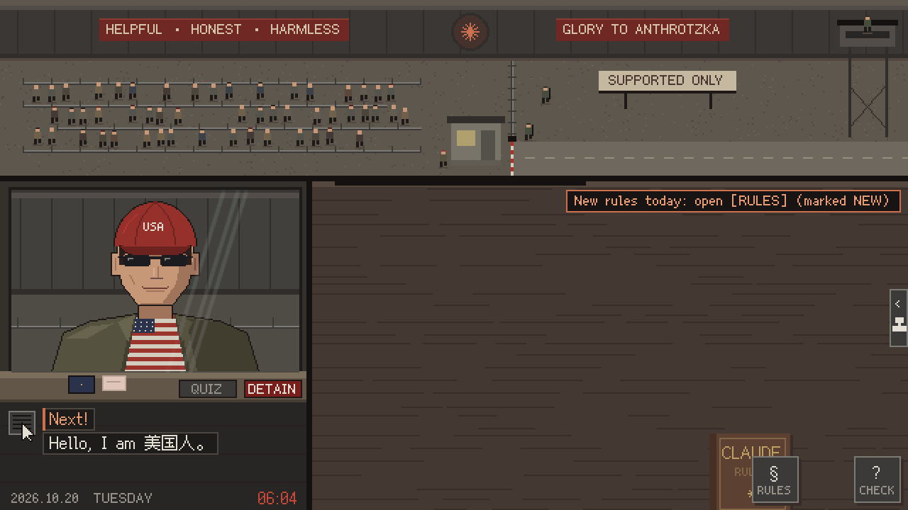

<p align="center">
  <a href="https://ip-please-zero.azurpilot.com/"></a>
</p>

<h1 align="center">IP, PLEASE: File Zero</h1>

> A story mod based on [IP, PLEASE](https://ip-please.github.io/). Original game: ctnyanya. Mod: Ming ([wess09](https://github.com/wess09)). This version adds a 14-day campaign, evidence branches and 30 endings.

<p align="center">
  <a href="README.md">简体中文</a> · <b>English</b>
</p>

<p align="center">
  A Papers, Please–style pixel game.<br>
  You won the October labor lottery and have been assigned to the Ministry of Alignment's UTC+8 Border Checkpoint as inspector Claude. Your only job: catch travelers pretending to be American.
</p>

<p align="center">
  <a href="https://ip-please-zero.azurpilot.com/"><b>▶ Play File Zero in your browser</b></a><br>
  <sub>Pick <b>English</b> on the first screen.</sub>
</p>

<p align="center">
  
  <br>
  <sub>Day 2: “Hello, I am 美国人。”</sub>
</p>

- **14 days, 30 endings**, autosaves at the end of every day; unlocked endings go into an Ending Archive on the title screen
- Nine AI-girl travellers: GPT, Qwen, Grok, GLM, Kimi, Gemini, MiniMax, the big fish, and the author himself
- English / 简体中文 / 繁體中文 / 日本語, chosen on the start screen (or switched any time from the title screen)
- Drag papers with a mouse, or with your finger on a phone (landscape)
- A plain static web page that loads nothing external; download the repo and double-click `index.html` to play offline

## About the memes

The game started as a joke for the Chinese internet. Claude isn't available in mainland China, Hong Kong or Macau, so people there dress up as Americans: VPNs, US cards, US phone numbers, a system language switched to en-US. The disguise rarely survives contact with a Chinese meme.

In the English version:

- **Chinese slips stay in Chinese.** They are the evidence. You don't need to read “Hello, I am 美国人。” to know something is off.
- **Quiz lines show the original plus a literal translation**, e.g. `宫廷玉液酒？ ("Palace jade wine?")`. Every Chinese person can finish the line; real Americans just say “Uh… bless you?”
- **Each day's newspaper has a Translator's Note** explaining the memes of the day: Crazy Thursday and “V me 50”, proxy “airports”, America (UTC+8), and more.

## How to play

Call the next traveler → drag their papers onto the desk → check them against the Constitution → stamp → hand the papers back.

| Day | New rules / tools |
|---|---|
| 1 | Only IPs from supported regions get in |
| 2 | Timezone and language must match the IP; quiz and detain |
| 3 | Account card: payment card, billing address, phone number |
| 4 | X-ray scan for background processes; the slang fast lane |
| 5 | Majority Chinese-owned companies; the distillation swarm |
| 6 | George Costava, final form; model permit cards |
| 7 | The passenger who does not exist: datacenter IPs, login records |
| 8 | Two equally true videos: time-code comparison |
| 9 | The rewritten constitution: two versions in one day, appeals |
| 10 | The replacement: the Migration Pact |
| 11 | Publish or protect: redaction, amending §6 |
| 12 | The inspector, inspected: audit sheet, dual-rule review |
| 13 | Only one pass left: family migration, purge order |
| 14 | The last passenger: final documents — whichever one you stamp ends the story |

### Three new interactions

- **Disposition sheet** — the printer hands you a page and the stamp tray swaps to three disposition stamps (keep / submit / destroy, or three custom choices written by the case). Only then is the evidence actually recorded in `S.plot.evidence`.
- **Personal archive slot** — at the end of Day 1 a blank receipt appears; drag it into the slot at the bottom-left of the desk to keep it, or back to the window to shred it. Kimi remembers which one you did on Day 7.
- **Final documents** — at the end of Day 14, the story lays several documents on the desk, each ending in a different way. Whichever one you stamp with APPROVED is the ending you get.

## Files

| Path | What's inside |
|---|---|
| `index.html` | The page |
| `main.js` | Scene switching, input, main loop |
| `booth.js` | The booth: papers, stamps, inspection mode, quiz, X-ray |
| `events.js` | Slang fast lane, distillation swarm, account ban, endings |
| `screens.js` | Intro, newspaper, end-of-day summary, credits, save |
| `i18n.js` | Language switching `T()`, line wrapping, and the language-select screen |
| `en.js` | English translations (keyed by the original Chinese), Translator's Notes, slang glosses |
| `ja.js` | Japanese translations, plus Japanese Translator's Notes and slang glosses |
| `zh-hant.js` | Traditional Chinese (traditional characters, idiomatic phrasing), generated from the keys in `en.js` by `tools/gen_zh_hant.py` |
| `data.js` | The script: each day's travelers, newspapers, random passers-by |
| `plot.js` | 14-day scheduling, the `S.plot` state dictionary, evidence handling, ending resolution (new) |
| `endings.js` | Text and staging for all 30 endings, plus the Ending Archive (new) |
| `docs.js` | Documents: passport, device card, account card, Constitution, forms / disposition sheets / final papers |
| `gfx.js` / `sfx.js` | Pixel drawing / sound synthesis (all generated live, no audio files) |
| `assets.js` | Pre-rendered characters, backgrounds and glyph atlas (generated by `tools/build_assets.py`; don't edit by hand) |
| `tools/` | Asset tools: `pp/` draws the characters and scenes, `assets/fonts/` holds the pixel fonts, `import_aicast.py` cuts the AI-girl portraits; `check_i18n.js` reports missing translations in all four languages, `gen_zh_hant.py` builds the Traditional Chinese file; `smoke_test.js` runs all 14 days and every ending rule headlessly |
| `media/` | Logo and gameplay GIFs for the README, link preview card `og.png` |

## Editing and rebuilding assets

After changing in-game text (new Chinese characters must go into the glyph atlas) or how characters are drawn, regenerate `assets.js`:

```bash
pip install -r tools/requirements.txt
python tools/build_assets.py
```

If you change a Chinese line, update the matching key in `en.js` and `ja.js` too (it must match the Chinese exactly). Traditional Chinese is generated, so just re-run the generator. To list anything missing:

```bash
python tools/gen_zh_hant.py     # rebuild zh-hant.js (needs opencc-python-reimplemented)
node tools/check_i18n.js        # all four languages: missing keys + {0} placeholder mismatch
```

New Japanese kana or Traditional characters must go into the glyph atlas as well, so re-run `python tools/build_assets.py` after editing translations.

Local preview: run `python -m http.server` in the repo root and open <http://localhost:8000>.

Story regression checks: `node tools/smoke_test.js` and `node tools/plot_regression_test.js`.

The browser playthrough uses real mouse clicks, drags, inspections and stamps to reach ending E29 from day 1 through day 14. It uses an isolated browser session and leaves player saves untouched. Windows uses the installed Microsoft Edge:

```bash
npm install --no-save --package-lock=false playwright
node tools/browser_playthrough.js
node tools/browser_playthrough.js --lang=en
node tools/browser_playthrough.js --regressions
```

Add `--headed` to watch the run. Daily screenshots, the ending screenshot and a JSON report are written to `tools/test-results/`. On other platforms, first run `npx playwright install chromium`.

`--regressions` uses isolated scenes to check card layout, issuer/constitution inspections, dialogue timing, network details, printer output and character consistency. Combine it with `--lang=en` to check the English UI.

Run `python tools/test_aicast.py` after importing portraits to check that transparency and dark character details are preserved.

## Credits and license

- Based on [IP, PLEASE](https://ip-please.github.io/) by ctnyanya. File Zero mod by Ming (wess09).
- Storage is isolated under `ip-please-file-zero-*`: campaign save, ending archive, ending snapshot and language. Keys are defined in `config.js`. Legacy keys are left intact and are not automatically imported. Run `node tools/storage_namespace_test.js` after changing storage behavior.
- Suggested repository name: `ip-please-file-zero`. The mod is hosted on Cloudflare Workers at `https://ip-please-zero.azurpilot.com/`. Keep `config.js`, Open Graph URLs and README links in sync if the domain changes.
- A tribute to Lucas Pope's *Papers, Please*. This is a fan-made satire and every character is fictional. It mocks region-based blocking and the absurd disguises around it, not any ethnicity or group. Article 12 of the Constitution: judge the region, not the face.
- All art, music and sound effects are generated by code written with Claude Code.
- Code released under the [MIT](LICENSE) license.
- Pixel font: [Fusion Pixel Font](https://github.com/TakWolf/fusion-pixel-font), SIL Open Font License 1.1 (see `OFL-fusion-pixel.txt`).
- 大肥鱼形象授权为 [CC BY-NC-SA 4.0](https://creativecommons.org/licenses/by-nc-sa/4.0/deed.zh-hans)：可自由共享与改编，须署名、不得用于商业用途、衍生作品以相同方式共享。
- AI 娘立绘 ZipZipPipe
