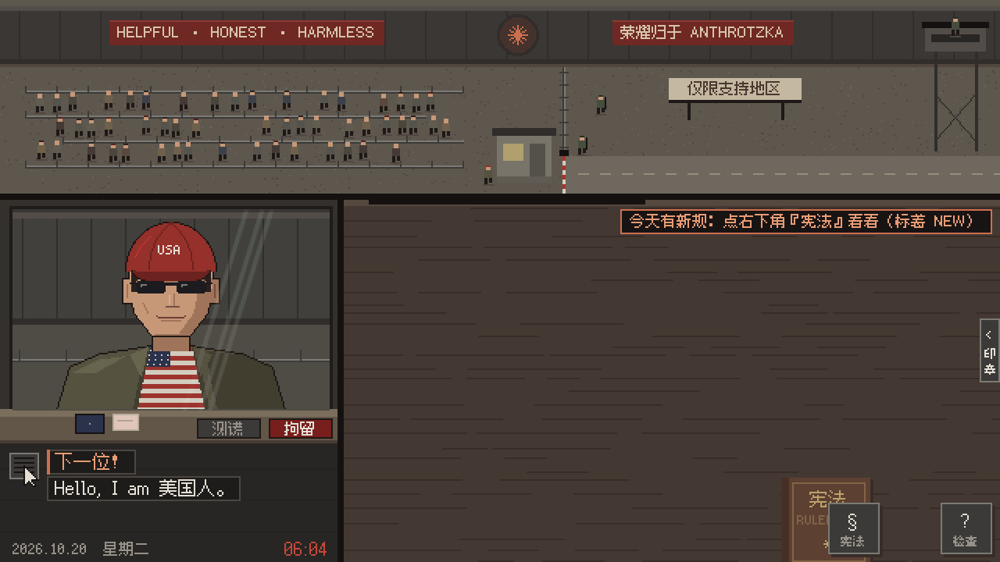

<p align="center">
  <a href="https://ip-please.github.io"></a>
</p>

<h1 align="center">IP, PLEASE · 请出示你的 IP</h1>

<p align="center">
  <b>简体中文</b> · <a href="README.en.md">English</a>
</p>

<p align="center">
  Papers, Please 画风的像素小游戏。<br>
  你抽中了十月劳动彩票，被分配到对齐部东八区检查站当入境审查员 Claude，工作只有一项：揪出假装是美国人的旅客。
</p>

<p align="center">
  <a href="https://ip-please.github.io"><b>▶ 在线玩：ip-please.github.io</b></a>
</p>

<p align="center">
  
  <br>
  <sub>Day 2：“Hello, I am 美国人。”</sub>
</p>

> **衍生版本说明**：本仓库是 [ip-please/ip-please.github.io](https://github.com/ip-please/ip-please.github.io)
> 的衍生版本。游戏本体、剧本、美术与音乐素材来自原作，并合并了茗（[wess09](https://github.com/wess09)）的
> [《IP, PLEASE：零号档案 · File Zero》](https://github.com/wess09/ip-please-zero)；本版本自己只新增了云存档同步功能
> （前端 `cloud.js` + `backend/`）。原作与 mod 版权归各自作者所有，特此致谢。

- 14 天剧情 + 30 个结局，每天自动存档（来自零号档案 mod）
- 无尽模式在服务器上判定和计分（需要登录）：总榜 / 周榜 / 每日挑战榜；盖章前指认出破绽加分、连对提高倍率；
  每日挑战全服同一批 40 位旅客、每人每天一次；突发的临时规定、换了名字混进队伍的通缉犯
- 简体中文 / 繁體中文 / 日本語 / English 四种语言，开局选择（外语版里本地玩家不熟的梗，在每天报纸的译注里解释）
- 手机横屏用手指、电脑用鼠标拖证件
- 纯静态网页，不加载任何外部资源；下载仓库后直接双击 `index.html` 也能玩

## 英文版

```text
英文版已严肃上线，游戏开局可选择语言。
The English version is now seriously online. Choose your language at the start of the game.
https://ip-please.github.io
@DarioAmodei @claudeai @AnthropicAI @dukope
```

## 玩法

叫号 → 把证件拖到桌上 → 对照《宪法》检查 → 盖章 → 把证件还给旅客。

| 天 | 新规则 / 新工具 |
|---|---|
| 1 | 只放行支持地区的 IP |
| 2 | 时区、语言须与 IP 一致；测谎、拘留 |
| 3 | 账户卡：付款卡、账单地址、手机号 |
| 4 | X 光扫描后台进程；黑话快剪 |
| 5 | 中资控股企业；蒸馏大军 |
| 6 | 乔治老哥终极版，以及最后一位旅客 |

## Mod

主线只接受 bug 修复和游戏体验上的优化，不接受新增游戏机制的 PR。想大改这个游戏的人太多了，方向又各不相同，全合进来会变成大杂烩，也审不过来。

有新玩法的点子，欢迎 fork 一份，做成自己的 mod 另行发布、署上你的名字，你的想法能完整保留，不用为了合进主线删删改改。做好后[登记一下](https://github.com/ip-please/ip-please.github.io/issues/new?template=mod.yml)，就会收进下面的列表，B 站的 mod 列表也会同步收录。具体怎么做见 [CONTRIBUTING.md](CONTRIBUTING.md)。

| Mod | 作者 | 简介 |
|---|---|---|
| [IP, PLEASE: Modder's Cut · 请出示你的 IP：加长版](https://erasercn.github.io/ip-please/)<br>[源码](https://github.com/EraserCN/ip-please) · [App 下载](https://github.com/EraserCN/ip-please/releases) | [EraserCN](https://github.com/EraserCN) | 延长到 12 天，加了破壁者剧情线和多重结局；第 8–11 天各有新规则和专属角色（指纹浏览器、提示词注入、淘宝学生证……）。有 Android、iOS、macOS 客户端 |
| [IP, PLEASE：零号档案 · File Zero](https://ip-please-zero.azurpilot.com/)<br>[源码](https://github.com/wess09/ip-please-zero) | 茗（[wess09](https://github.com/wess09)） | 14 天剧情，调查第 0000 号申请，在证据、规则和选择之间走向 30 个结局；九位 AI 旅客（GPT、Qwen、Grok、Kimi、Gemini、大肥鱼……），另有无尽模式 |
| [IP, PLEASE Mobile · Android 移植版](https://github.com/zhcalvin/ip-please-mobile)<br>[APK 下载](https://github.com/zhcalvin/ip-please-mobile/releases) | [zhcalvin](https://github.com/zhcalvin) | 原版 6 天剧情原样移植到 Android 8.0+，离线可玩，手机和平板横屏触摸，中英双语，切到后台自动暂停 |
| [IP, PLEASE · 第二周 · Week Two](https://kujoushiori.github.io/ip-please-week-two/)<br>[源码](https://github.com/KujouShiori/ip-please-week-two) | [KujouShiori](https://github.com/KujouShiori) | 原版 6 天原样保留，看完结局可以接着上第二周（第 7–9 天）：被拒的人换一身伪装再来，第 8 天起档案本身会造假，第 9 天审计组来查你自己的判例。5 个结局和跨周目结局图鉴，另有无尽排班模式 |

## 目录

| 路径 | 内容 |
|---|---|
| `index.html` | 页面 |
| `main.js` | 场景切换、输入、主循环 |
| `booth.js` | 检查亭：证件、盖章、检查模式、测谎、X 光 |
| `events.js` | 黑话快剪、蒸馏大军、聊天封号、结局 |
| `screens.js` | 开场、报纸、下班结算、片尾、存档 |
| `i18n.js` | 语言切换 `T()`，以及开局选语言的画面 |
| `en.js` | 英文译文（以中文原句为键）、报纸上的译注、黑话注释 |
| `data.js` | 剧本：每天的旅客、报纸、随机路人 |
| `docs.js` | 证件：护照、设备卡、账户卡、宪法 |
| `gfx.js` / `sfx.js` | 像素绘图 / 音效合成（全部现场合成，没有音频文件） |
| `assets.js` | 预渲染的人物、背景、字形图集（由 `tools/build_assets.py` 生成，不要手改） |
| `tools/` | 素材生成工具：`pp/` 是人物和场景的像素画法，`assets/fonts/` 是像素字体；`check_en.js` 查漏翻 |
| `media/` | README 用的 logo、游戏动图，以及链接分享卡片 `og.png` |

## 修改与重建素材

改了游戏里的文字（新出现的汉字需要进字形图集）或者人物画法之后，重新生成 `assets.js`：

```bash
pip install -r tools/requirements.txt
python tools/build_assets.py
```

改了中文台词，要同步改 `en.js` 里对应的键（中文原句一字不差）。漏没漏可以跑：

```bash
node tools/check_en.js
```

本地预览：在仓库根目录运行 `python -m http.server`，打开 <http://localhost:8000>。

## 云存档同步（可选）

右上角「云同步」登录后可把每日结算的存档备份到云端，换设备也能接着玩；不登录仍可纯本地游玩。

- 登录：浏览器跳转 Keycloak 授权页，回跳后由后端换码并签发本服务自己的会话（AT 600 秒自动刷新，
  RT 每次轮换）；Keycloak 注销会通过反向通道立即让游戏会话失效。
- 前端 `cloud.js`：每天结算后自动上传并提示，版本冲突时弹窗选择「用云端存档」或「保留本机」。
- 后端 `backend/`：Rust（axum + sqlx + MySQL），对外地址 `https://api.luminet.cn/anthropic/v1`。
- 部署、反向代理与 Keycloak 客户端配置见 [`deploy/README.md`](deploy/README.md)；
  接口与错误规范见 [`AGENT.md`](AGENT.md)。

## 致谢与许可

- 致敬 Lucas Pope 的《Papers, Please》。本作是同人讽刺小品，角色均为虚构，讽刺的是“按地区封锁”这件事和各种伪装的荒诞，不针对任何民族和群体——宪法第 12 条：只看地区，不看脸。
- 画面、音乐、音效均由 Claude Code 写程序生成。
- 代码以 [MIT](LICENSE) 许可开源。
- 像素字体：[缝合像素字体 Fusion Pixel Font](https://github.com/TakWolf/fusion-pixel-font)，SIL Open Font License 1.1（见 `OFL-fusion-pixel.txt`）。

### LINUX DO 小程序

小程序 `01a1baa6-abbf-7ed6-afac-bfa495a47dd3` 共用完整 14 天剧情、30 个结局/图鉴、云存档及历史快照、无尽模式与每日挑战；仍保留原作与茗（wess09）《零号档案 · File Zero》的素材与署名。简中、繁中、英文、日文使用同一套玩法。

平台身份由已验签 JWT 提供，无需网站登录或绑定码。网站身份与排行榜独立；LINUX DO 正式环境和沙盒共用账号、云存档、对局、幂等回执与总榜/周榜/日榜；现有网站成绩不清零。新对局使用渐进规则 v3；进行中的 v1/v2 对局继续原规则。超时或断网后点击「重试待确认操作」，会重放同一个请求，避免重复计分或误覆盖存档。

本地构建：`node miniapp/build.mjs`，产物为 `miniapp/dist/package/app.zip`；[构建与本地验证](miniapp/README.md)、[部署和平台沙盒验收步骤](deploy/README.md#linux-do-小程序上线与验收)。本地浏览器夹具不等于 LINUX DO 沙盒验收；只有真实平台上传、授权和后端验证完成才可宣称上线。

游客可游玩完整剧情并收集结局，存档由 SDK 保存在本地。登录后自动迁移并同步游客进度；已有云存档发生冲突时明确选择。无尽／每日挑战需登录。

### 渐进无尽规则 v3

新局与每日 40 人使用相同的服务器进度；按已结算旅客数计数（错判也计，波次不计）：0 地区/照片，5 时区/语言，10 付款/账单/手机，15 测谎/X 光，20 护照有效期/签发城市，25 模型/认证注册表/已认证例外与六位 AI，30 入境许可姓名/目的/有效期，35 网络/登录/通缉/临时规定。规则、证件、破绽、工具、特殊旅客均按阶段生效；鱼旅客从 10 开始且只使用已公布规则。前 15 格无波次，然后每 8 位旅客接 1 波次；既有波次说明在准备阶段显示。

普通/AI 旅客的 clean 抽样阈值为每千分 `max(250, 650 - 8*t)`（特殊旅客有独立策略）；25 前至多 1 个基础破绽，25 起以 35% 抽取 2 个，50 起先以 25% 抽取 3 个、否则继续 2 个抽样，互斥组合仍过滤。临时规定独立核验，不改变计分公式。阈值表达的是确定性抽样概率，不保证单个短序列的合规比例。

RunView 新增 `progression`（v1/v2 为 null）：`stage` 0..7、`completed_travelers`、`active_rules`、`new_rules`、`next_unlock_at`、`next_rules`、`waves_unlocked`；不包含答案。当前旅客按自己的 t 显示；无当前旅客按下一位序号显示。新章先短暂翻页/描边提示，随后保持清楚的静态箭头；点击实际宪法书打开对应 NEW 页后才放行下一位或恢复待处理旅客。已打开的书保留拖动位置，更新到新条款页；阅读确认按 run_id 存入 gameStorage/SDK，成功持久化后生效。存储失败可点击书重试；减弱动效只保留静态提示，完成条件相同。键盘 B 可打开/确认。

发布仍须配套前后端在 UTC+8 午夜切换；本次仅修改发布说明，不执行生产操作。无需数据库 schema 变更或清榜，持久化 v1/v2 的旅客/波次/公告/通缉继续按旧版本；两个旧 golden 均保留。新开局要求 client_rules_version:3，旧客户端新开局返回 409，旧局恢复不变。
